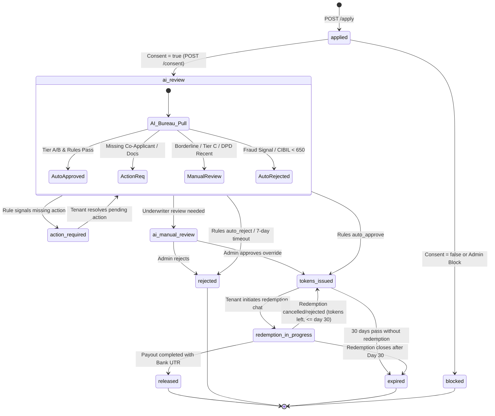

# Livana Zero Deposit (Credit Tokens) v2 — Frontend API & Integration Guide

> **Audience**: Frontend Engineers (Tenant Mobile App, Web App, and Admin Backoffice)  
> **Backend Version**: LivanaEco Axum Backend v2 (`release/zero-deposit-v2`)  
> **Tenant Base Path**: `/api/v1/zero-deposit` (Scoped to caller `user_id` via JWT)  
> **Admin Base Path**: `/api/admin/zero-deposit` (Guarded by `admin_auth_guard` + transactional audit logging)  
> **WebSocket Gateway**: `/api/v1/ws` (Chat & real-time notification push)

---

## 1. System Architecture & Core Concept

Livana has **no NBFC partner**. Livana funds 100% of the Zero Deposit program internally via **Credit Tokens**:
- **1 Token = ₹1 INR** of non-transferable security deposit cover.
- **Deposit Calculation**: Exactly **3 × monthly rent** (e.g. ₹10,000 rent → ₹30,000 deposit tokens).
- **Token Expiry**: Fixed strictly at **30 days** from issuance (`issued_at + 30 days`). No extensions or rollovers.
- **Fee Model**: $\text{First month's rent} + \text{flat ₹2,000}$ processing charge.
- **Usage Model**: Tokens can **only** be redeemed through an interactive **Redemption Chat** with the Livana Admin Team.
- **Payout Flow**: Two-admin **Maker-Checker** pattern:
  1. *Admin 1 (Maker)* reviews documents and approves redemption.
  2. *Admin 2 (Checker)* transfers funds directly to the landlord's verified bank account outside the system, enters the Bank UTR reference, and marks the redemption as `released`.

```
+-------------+         Apply & Consent         +------------------------+
|  Tenant App | ------------------------------> | Bureau & AI Evaluation |
+-------------+                                 +------------------------+
       |                                                    |
       | 3x Rent Tokens Issued                              v
       | (Valid Exactly 30 Days)                +------------------------+
       |<-------------------------------------- | Status: tokens_issued  |
       |                                        +------------------------+
       v
+------------------------------------------------------------------------+
|                      Redemption Chat Screen                            |
|             (Labelled "Livana Zero Deposit" in Chat List)              |
|                                                                        |
|  * Upload: Rental Agreement, Landlord PAN, Aadhaar, Bank Proof, etc.   |
|  * Admin 1 (Maker): Reviews documents & approves payout                |
|  * Admin 2 (Checker): Pays landlord via NEFT/RTGS & enters Bank UTR    |
|  * Tokens moved from "locked" -> "redeemed"                            |
+------------------------------------------------------------------------+
```

---

## 2. Breaking Changes From Legacy v1

| Feature | Legacy v1 | New v2 (Current) |
| :--- | :--- | :--- |
| **Financing Partner** | Third-party NBFC (FLDG, external disbursement) | **Livana Direct Funding** via Credit Tokens. |
| **NBFC Endpoints** | `/api/nbfc/*`, `/assign-nbfc`, `/nbfc-partners` | **Permanently Deleted**. Do not invoke or design screens for these. |
| **Application Body** | `requested_deposit_amount`, `itr_document_url`, etc. | Replaced by `occupants`, `documents`, `tenancy_months`, `employment_type`. |
| **Application Status** | Used `pending_review` and `fee_pending` | `pending_review` dropped for new apps. Fee payment **never** mutates app status. |
| **New Lifecycle Values**| `applied`, `approved`, `rejected` | `ai_review`, `action_required`, `ai_manual_review`, `tokens_issued`, `redemption_in_progress`, `released`, `expired`. |
| **Assessment Endpoint** | Score and bureau dumps exposed | Clean tenant-safe endpoint (`GET /api/v1/zero-deposit/{id}/assessment`). |
| **Redemption Mechanism**| Generic form submit | **In-app Chat with Admin** (`chat_type: "zd_redemption"`). |
| **State Mutations** | Permissive updates | **Strict SQL Enforcement** (`WHERE status = '<expected>'`). Invalid moves yield HTTP `409 INVALID_STATE`. |
| **Deposit Field** | `requested_deposit_amount` | `deposit_amount` (`NUMERIC(12,2)`). |

---

## 3. Application Lifecycle State Machine



### Application State Reference

| Status | Frontend UI Guidance |
| :--- | :--- |
| `applied` | Show initial checklist. Prompt for Credit Bureau Check Consent. |
| `ai_review` | Show animated scanner: *"Checking eligibility and verifying credentials..."* |
| `action_required` | Display actionable banners from `pending_actions` array (e.g. `add_co_applicant`, `work_email_otp`, `upload_salary_slips`). |
| `ai_manual_review` | Show banner: *"Your application is being reviewed by our underwriter team (typically 12–24h)."* |
| `tokens_issued` | **Active Wallet State**: Show token balance ($3 \times \text{monthly rent}$), upfront fee breakdown, and countdown timer (30 days). Show button: `[Redeem Zero Deposit]`. |
| `redemption_in_progress` | Show active redemption status card and direct link to the **"Livana Zero Deposit"** chat. |
| `released` | Success state: *"Zero Deposit is Active! Landlord deposit covered."* Display Bank UTR and coverage certificate. |
| `rejected` | Explain rejection reasons (from `reason_codes`) and display re-application eligibility window. |
| `expired` | Tokens expired: *"Your token eligibility period has expired. Re-apply to generate fresh tokens."* |
| `blocked` | Account ineligible or consent denied. Direct to customer support. |

---

## 4. Tenant API Endpoints

All tenant endpoints require a valid user JWT in the header:
```http
Authorization: Bearer <tenant_jwt_token>
Content-Type: application/json
```

### 4.1 Create Application
- **Path**: `POST /api/v1/zero-deposit/apply`
- **Description**: Submits tenant profile, rent figures, occupants, and document URLs.
- **Validations**:
  - `tenancy_months >= 11` (returns `422 TENANCY_TOO_SHORT` if $< 11$).
  - `salaried`: Requires 3 salary slip URLs OR an offer letter URL, plus bank statement URL (returns `422 DOCUMENTS_MISSING` if missing).
  - `self_employed`: Requires GST returns or ITR URL, plus bank statement URL (returns `422 DOCUMENTS_MISSING` if missing).

#### Request Body
```json
{
  "property_id": "019d1234-abcd-7000-8000-000000000001",
  "kyc_id": "019d1234-abcd-7000-8000-000000000002",
  "monthly_rent": 10000.00,
  "tenancy_months": 11,
  "employment_type": "salaried", // "salaried" | "self_employed" | "gig" | "student"
  "employer_name": "Tata Consultancy Services",
  "current_job_start_date": "2024-06-01",
  "total_experience_months": 30,
  "business_start_date": null,
  "declared_monthly_income": 32000.00,
  "variable_pay_monthly": 0.00,
  "is_repeat_renter": true,
  "occupants": {
    "adults": 2,
    "children": 0,
    "pets": false,
    "sharing": false,
    "co_occupants": [
      { "name": "Pooja Verma", "relation": "spouse" }
    ]
  },
  "documents": {
    "bank_statement_url": "https://s3.ap-south-1.amazonaws.com/.../statement.pdf",
    "salary_slip_urls": [
      "https://s3.ap-south-1.amazonaws.com/.../slip1.pdf",
      "https://s3.ap-south-1.amazonaws.com/.../slip2.pdf",
      "https://s3.ap-south-1.amazonaws.com/.../slip3.pdf"
    ],
    "offer_letter_url": null,
    "itr_url": null,
    "gst_return_urls": [],
    "address_proof_url": "https://s3.ap-south-1.amazonaws.com/.../address.pdf"
  }
}
```

#### Response (`201 Created`)
```json
{
  "success": true,
  "message": "zero_deposit application submitted successfully",
  "data": {
    "zero_deposit": {
      "id": "c1f76d49-43c2-4013-8cfb-69bc3c27181c",
      "user_id": "019d08e2-f67b-7b00-a7d2-7c9339e0839e",
      "monthly_rent": 10000.00,
      "deposit_amount": 30000.00, // Computed: 3 x monthly_rent
      "fee_amount": 12000.00,     // Computed: monthly_rent + ₹2,000
      "first_rent_amount": 10000.00, // Computed: monthly_rent
      "status": "applied",
      "consent_given": false,
      "created_at": "2026-11-11T12:00:00Z"
    }
  }
}
```

---

### 4.2 Submit Bureau & Assessment Consent
- **Path**: `POST /api/v1/zero-deposit/credit-check/consent`
- **Description**: Gives tenant consent. Queues the AI & deterministic rules engine assessment job on Redis.
- **Authorization**: Caller JWT must match application `user_id` (returns `403 NOT_OWNER` otherwise).

#### Request Body
```json
{
  "zero_deposit_id": "c1f76d49-43c2-4013-8cfb-69bc3c27181c",
  "consent_given": true
}
```

#### Response (`200 OK` on consent = true)
```json
{
  "success": true,
  "message": "Consent updated successfully",
  "data": {
    "zero_deposit": {
      "id": "c1f76d49-43c2-4013-8cfb-69bc3c27181c",
      "status": "ai_review",
      "consent_given": true,
      "assessment_status": "queued",
      "updated_at": "2026-11-11T12:01:00Z"
    }
  }
}
```

*(Note: If `consent_given: false` is passed, `status` moves to `blocked`)*.

---

### 4.3 Fetch Tenant-Safe Assessment Result
- **Path**: `GET /api/v1/zero-deposit/{id}/assessment`
- **Description**: Exposes clean, tenant-facing assessment results.
- **Security**: Strips raw credit bureau scores, fraud engine flags, and internal ML model parameters.

#### Response (`200 OK` - Auto Approved Example)
```json
{
  "success": true,
  "data": {
    "outcome": "approved", // "approved" | "action_required" | "under_review" | "rejected" | "pending"
    "tier": "B",           // "A" | "B" | "C" | null
    "tokens_issued": 30000.00,
    "reasons": [
      "Credit profile meets Livana Tier B requirements"
    ],
    "pending_actions": [],
    "co_applicant_due_by": null,
    "assessed_at": "2026-11-11T12:02:30Z"
  }
}
```

#### Response (`200 OK` - Action Required Example)
```json
{
  "success": true,
  "data": {
    "outcome": "action_required",
    "tier": "C",
    "tokens_issued": null,
    "reasons": [
      "Co-applicant required for Tier C assessment",
      "Official employer email verification pending"
    ],
    "pending_actions": [
      "add_co_applicant",
      "work_email_otp"
    ],
    "co_applicant_due_by": "2026-11-18T12:02:30Z", // Exactly 7 days window
    "assessed_at": "2026-11-11T12:02:30Z"
  }
}
```

---

### 4.4 Fetch Full Application & Active Token Wallet
- **Path**: `GET /api/v1/zero-deposit/{id}`
- **Description**: Returns the comprehensive application record and token balance.

#### Response (`200 OK`)
```json
{
  "success": true,
  "data": {
    "zero_deposit": {
      "id": "c1f76d49-43c2-4013-8cfb-69bc3c27181c",
      "status": "tokens_issued",
      "monthly_rent": 10000.00,
      "deposit_amount": 30000.00,
      "fee_amount": 12000.00,
      "pending_actions": [],
      "token_allocation": {
        "id": "019d08e2-aaaa-bbbb-cccc-111122223333",
        "issued": 30000.00,
        "available": 30000.00,
        "locked": 0.00,
        "redeemed": 0.00,
        "status": "active",
        "expires_at": "2026-12-11T12:00:00Z", // Exactly +30 days
        "days_remaining": 30
      }
    }
  }
}
```

---

### 4.5 List My Zero Deposits
- **Path**: `GET /api/v1/zero-deposit/me`
- **Description**: Returns all applications belonging to the authenticated tenant.

---

### 4.6 Open or Retrieve Redemption Chat
- **Path**: `POST /api/v1/zero-deposit/{id}/redemptions`
- **Description**: Creates a redemption draft and connects to the dedicated redemption chat.
- **Idempotency**: Pass `Idempotency-Key` header to prevent duplicate redemptions.

#### Request Body
```json
{
  "tokens_requested": 30000.00,
  "property_id": "019d1234-abcd-7000-8000-000000000001",
  "landlord_name": "Suresh Mehta",
  "landlord_phone": "+919876543210"
}
```

#### Response (`201 Created` or `200 OK`)
```json
{
  "success": true,
  "data": {
    "redemption": {
      "id": "019d08f0-1111-2222-3333-444455556666",
      "chat_id": "019d08f0-9999-8888-7777-666655554444",
      "status": "docs_pending",
      "tokens_requested": 30000.00,
      "required_documents": [
        "rental_agreement",
        "landlord_pan",
        "landlord_aadhaar",
        "landlord_bank_proof",
        "property_ownership_proof"
      ]
    }
  }
}
```

---

### 4.7 Upload Document into Redemption
- **Path**: `POST /api/v1/zero-deposit/redemptions/{redemption_id}/documents`
- **Content-Type**: `multipart/form-data`
- **File Limits**: Max 10MB; Allowed: `.pdf`, `.jpg`, `.jpeg`, `.png`.

#### Form Fields:
- `doc_type`: `rental_agreement` | `landlord_pan` | `landlord_aadhaar` | `landlord_bank_proof` | `property_ownership_proof`
- `file`: Binary file upload

---

### 4.8 Submit Redemption for Review
- **Path**: `POST /api/v1/zero-deposit/redemptions/{redemption_id}/submit`
- **Description**: Locks the requested tokens in the ledger and shifts redemption status to `under_review`.

---

### 4.9 Employer Verification Endpoints

When an application requires employer verification (`pending_actions` contains `"work_email_otp"` or `"verify_work_email"`):

#### 1. Send OTP to Official Corporate Email
- **Path**: `POST /api/v1/zero-deposit/{zero_deposit_id}/employer-verification/send-otp`
- **Description**: Sends a 6-digit OTP to corporate email. Free/personal email domains (e.g. `@gmail.com`, `@yahoo.com`, `@outlook.com`) return HTTP `422 PERSONAL_EMAIL_NOT_ALLOWED`.
- **OTP Expiry**: Exactly 10 minutes.
- **Request Body**:
```json
{
  "official_email": "rahul.verma@tcs.com"
}
```
- **Response (`200 OK`)**:
```json
{
  "success": true,
  "message": "OTP sent to official email successfully",
  "data": { "validity_minutes": 10 }
}
```

#### 2. Verify Corporate Email OTP
- **Path**: `POST /api/v1/zero-deposit/{zero_deposit_id}/employer-verification/verify`
- **Description**: Validates OTP. Maximum 5 attempts allowed. After 5 attempts, verification is marked `failed` triggering auto-reject `EMPLOYER_VERIFICATION_FAILED` on the next evaluation.
- **On Success**: Automatically moves application back to `ai_review` and triggers re-assessment!
- **Request Body**:
```json
{
  "otp": "482910"
}
```
- **Response (`200 OK`)**:
```json
{
  "success": true,
  "message": "Employer email verified successfully. Application moved to AI review."
}
```

#### 3. Admin HR Verification (When tenant has no official email)
- **Path**: `PATCH /api/admin/zero-deposit/{zero_deposit_id}/employer-verification`
- **Guarded By**: `admin_auth_guard` (Maker action logged in audit trail).
- **Request Body**:
```json
{
  "status": "verified", // "verified" | "failed"
  "method": "hr_call",  // "hr_call" | "hr_email"
  "employer_category": "registered_company", // "registered_company" | "mnc" | "government_psu" | "startup" | "other"
  "remarks": "Spoke with HR manager Sunita; confirmed active permanent employment."
}
```

---

### 4.10 Co-Applicant Workflow

Required for students, freshers, new-to-credit, scores 650–699, or low income. A co-applicant must have CIBIL 700+, complete KYC and consent, and e-sign the agreement.

#### 1. Invite Co-Applicant (Tenant Action)
- **Path**: `POST /api/v1/zero-deposit/{zero_deposit_id}/co-applicant`
- **Constraint**: Only one active co-applicant invitation permitted per application.
- **Expiry**: 7 days (`due_by`). If 7 days lapse without acceptance, application auto-rejects.
- **Request Body**:
```json
{
  "name": "Kavita Sharma",
  "relation": "parent",
  "mobile": "+919876543210",
  "email": "kavita.sharma@gmail.com",
  "employment_type": "salaried",
  "declared_monthly_income": 60000.00
}
```
- **Response (`201 Created`)**:
```json
{
  "success": true,
  "message": "Co-applicant invited successfully",
  "data": { "co_applicant_id": "019d08e2-xxxx-yyyy-zzzz", "window_days": 7 }
}
```

#### 2. Remove/Cancel Co-Applicant Invite
- **Path**: `DELETE /api/v1/zero-deposit/{zero_deposit_id}/co-applicant/{co_applicant_id}`
- **Constraint**: Permitted **only before** co-applicant accepts (`status === "invited"`).

#### 3. View Invites Addressed to Co-Applicant
- **Path**: `GET /api/v1/zero-deposit/co-applicant-invites/me`
- **Description**: Returns all pending invitations matching caller's registered phone or email.

#### 4. Accept Co-Applicant Invite
- **Path**: `POST /api/v1/zero-deposit/co-applicant-invites/{co_applicant_id}/accept`
- **Description**: Submits consent and pulls bureau. If CIBIL $< 700$, invite is `rejected`. If $\ge 700$, invite is `accepted`, application moves back to `ai_review`, and rules engine re-evaluates automatically!
- **Request Body**:
```json
{
  "kyc_id": "019d08e2-kyc1-kyc2-kyc3",
  "consent_given": true,
  "bank_statement_url": "https://s3.amazonaws.com/livana/coapp_stmt.pdf",
  "salary_slip_urls": ["https://s3.amazonaws.com/livana/coapp_slip1.pdf"]
}
```

#### 5. Admin View Co-Applicants
- **Path**: `GET /api/admin/zero-deposit/{zero_deposit_id}/co-applicants`
- **Description**: Returns all co-applicants for the application with KYC, CIBIL, and e-sign status.

---

### 4.11 Landlord Reference Workflow

Required for Tier C applicants.

#### 1. Submit Landlord Reference (Tenant Action)
- **Path**: `POST /api/v1/zero-deposit/{zero_deposit_id}/landlord-reference`
- **Request Body**:
```json
{
  "landlord_name": "Ramesh Gupta",
  "landlord_mobile": "+919811223344",
  "previous_address": "Flat 302, Palm Heights, Indiranagar, Bengaluru",
  "tenancy_from": "2023-04-01",
  "tenancy_to": "2024-03-31",
  "monthly_rent": 12000.00,
  "rent_receipt_urls": ["https://s3.amazonaws.com/livana/receipt_mar2024.pdf"]
}
```

#### 2. Admin Verify Landlord Reference
- **Path**: `PATCH /api/admin/zero-deposit/{zero_deposit_id}/landlord-reference/{reference_id}`
- **Statuses**:
  - `verified`: Clears pending action and transitions application back to `ai_review`.
  - `negative`: Transitions application to `ai_manual_review` with reason `LANDLORD_REFERENCE_NEGATIVE`.
  - `unreachable`: Flags as unreachable.
- **Request Body**:
```json
{
  "status": "verified",
  "remarks": "Landlord confirmed 12 months on-time rent payment with no property damages."
}
```

---

### 4.12 Payments & Autopay Setup

#### 1. Initiate Fee Charge (Server-Side Computed)
- **Path**: `POST /api/v1/zero-deposit/{zero_deposit_id}/fee/charge`
- **Amount Rule**: $\text{Fee} = \text{monthly\_rent} + ₹2,000$; $\text{First Rent} = \text{monthly\_rent}$; $\text{Total} = \text{Fee} + \text{First Rent}$.
- **Important**: This endpoint **never mutates application status** (it stops setting `fee_pending`).
- **Request Body**:
```json
{
  "upi_vpa": "rahul@okaxis"
}
```
- **Response (`200 OK`)**:
```json
{
  "success": true,
  "message": "Fee and first rent charge initiated successfully",
  "data": {
    "fee_transaction_id": "019d08e2-fee1-fee2-fee3",
    "fee_amount": 12000.00,       // ₹10,000 rent + ₹2,000 flat fee
    "first_rent_amount": 10000.00,// ₹10,000 first month's rent
    "total_amount": 22000.00,     // Total collected via UPI
    "status": "pending",
    "upi_vpa": "rahul@okaxis",
    "created_at": "2026-11-12T14:00:00Z"
  }
}
```

#### 2. Setup Autopay Mandate (Bank Account Masked)
- **Path**: `POST /api/v1/zero-deposit/{zero_deposit_id}/autopay/setup`
- **Masking Guarantee**: Bank account numbers in responses are **always masked to last 4 digits** (`****1234`).
- **Request Body**:
```json
{
  "mandate_type": "nach", // "nach" | "upi_autopay"
  "bank_account_number": "123456789012",
  "ifsc": "HDFC0001234"
}
```
- **Response (`200 OK`)**:
```json
{
  "success": true,
  "message": "Autopay mandate setup initiated",
  "data": {
    "autopay_mandate": {
      "id": "019d08e2-mand-ate1-ate2",
      "zero_deposit_id": "c1f76d49-43c2-4013-8cfb-69bc3c27181c",
      "mandate_type": "nach",
      "bank_account_number": "****9012", // Strictly masked
      "ifsc": "HDFC0001234",
      "status": "pending"
    }
  }
}
```

#### 3. Repayment Schedule & Delinquency Ledger
- **Paths**:
  - `GET /api/v1/zero-deposit/{zero_deposit_id}/repayment-schedule`
  - `GET /api/v1/zero-deposit/{zero_deposit_id}/ledger`
- **Ownership**: Strictly scoped to caller (`403 NOT_OWNER` if accessed by another user).

---

### 4.13 Token Wallet Endpoints

#### 1. Get Token Wallet
- **Path**: `GET /api/v1/zero-deposit/tokens/wallet`
- **Description**: Returns all token allocations and active unexpired available balance for the logged-in tenant.
- **Response (`200 OK`)**:
```json
{
  "success": true,
  "data": {
    "allocations": [
      {
        "allocation_id": "019d08e2-aaaa-bbbb-cccc-111122223333",
        "zero_deposit_id": "c1f76d49-43c2-4013-8cfb-69bc3c27181c",
        "property_id": "019d1234-abcd-7000-8000-000000000001",
        "issued": 30000.00,
        "available": 30000.00,
        "locked": 0.00,
        "redeemed": 0.00,
        "status": "active",
        "expires_at": "2026-12-11T12:00:00Z"
      }
    ],
    "total_available": 30000.00
  }
}
```

#### 2. Get Token Transactions
- **Path**: `GET /api/v1/zero-deposit/tokens/transactions?allocation_id={id}&limit=50&offset=0`
- **Description**: Returns append-only transaction history sorted newest first. Scoped to caller (`403 NOT_OWNER` if `allocation_id` belongs to another tenant).
- **Response (`200 OK`)**:
```json
{
  "success": true,
  "data": {
    "transactions": [
      {
        "id": "019d08e2-tx11-tx22-tx33",
        "allocation_id": "019d08e2-aaaa-bbbb-cccc-111122223333",
        "type": "issue",
        "amount": 30000.00,
        "balance_after": 30000.00,
        "reference_id": "019d08e2-ref1-ref2-ref3",
        "created_at": "2026-11-11T12:00:00Z"
      }
    ]
  }
}
```

---

### 4.14 Webhooks Integration

#### 1. Repayment Webhook
- **Path**: `POST /api/v1/zero-deposit/webhook/repayment-status`
- **Header**: `x-webhook-signature` (HMAC SHA-256)
- **Features**: Idempotent. Late payments reset `on_time_months` to 0 and downgrade tenant tier. On-time payments increment `on_time_months` and auto-upgrade after 6 consecutive months.

#### 2. Fee Webhook
- **Path**: `POST /api/v1/zero-deposit/webhook/fee-status`
- **Header**: `x-webhook-signature` (HMAC SHA-256)
- **Features**: Idempotent. Confirms fee and first rent together into `ledger_entries`. Does not touch application status.

#### 3. E-Sign Webhook
- **Path**: `POST /api/v1/zero-deposit/webhook/esign-status`
- **Features**: Updates tenant or co-applicant `esigned_at` timestamp and posts an automated status message in the redemption chat.

---

## 5. Deterministic Rules Engine Reference

Tenants qualify based on **Rent-Paying Reliability**, not loan capacity:
1. **Income Considered**:
   - **Salaried**: Net monthly take-home + variable pay counted at 50% (100% if shown for 6+ months). Minimum income: $3 \times \text{monthly rent}$.
   - **Self-Employed**: 6-month average bank credits $\times 50\%$. Minimum income: $3 \times \text{monthly rent}$.
   - **Gig / Freelance**: 6-month average bank credits $\times 50\%$. Minimum income: $3.5 \times \text{monthly rent}$.
   - **Student / No Income**: Evaluated on co-applicant's income ($3 \times \text{monthly rent}$).
2. **Obligation Caps**:
   - Total obligations (Rent + EMIs + Card dues) must be $\le 50\%$ of income considered.
   - Rent alone must be $\le 35\%$ of income considered.
3. **Credit Bureau & Tiering Matrix**:
   - **Tier A** (Max rent ₹40,000): CIBIL 750+, salaried with 1+ year in current job.
   - **Tier B** (Max rent ₹25,000): CIBIL 700–749, or 750+ self-employed.
   - **Tier C** (Max rent ₹15,000): CIBIL 650–699 or new-to-credit (requires co-applicant with 700+ AND prior landlord reference).
   - **Auto Reject**: CIBIL $< 650$, any write-off / settlement / suit-filed account, or cheque/ECS bounce in last 3 months.
4. **Nightly Tier Evolution**:
   - Tenancy on-time rent $\ge 6 \text{ months}$ moves tier **UP** one level ($C \to B \to A$).
   - Any late payment moves tier **DOWN** one level and resets on-time counter to 0.

---

## 6. Real-Time Chat & WebSocket Integration

The chat system uses the shared WebSocket endpoint at `/api/v1/ws`.

### 6.1 Identifying the Redemption Chat
In the tenant's chat list (`GET /api/v1/chats`):
- Filter by `chat_type === "zd_redemption"`.
- Display title: **"Livana Zero Deposit"**.
- Display subtitle: Status of redemption (e.g. *"Under Review"*, *"Changes Requested"*).

### 6.2 Message Structure & Special Event Types
Incoming messages over WebSocket have this schema:

```typescript
interface ZdChatMessage {
  id: string;
  chat_id: string;
  sender_type: "tenant" | "admin" | "system";
  sender_id: string | null; // null for automated system messages
  message_type: "text" | "doc_request" | "doc_review" | "status";
  content: string;
  metadata: {
    doc_type?: string;
    doc_status?: "verified" | "rejected";
    rejection_reason?: string;
    old_status?: string;
    new_status?: string;
    utr?: string;
  } | null;
  created_at: string;
}
```

#### Custom Message Rendering on Frontend:
1. **`message_type: "doc_request"`**:
   Render an interactive document upload card in the chat stream with an `[Upload <DocName>]` button.
2. **`message_type: "doc_review"`**:
   Render an inspection badge: green check for verified or red warning with `rejection_reason` for rejected.
3. **`message_type: "status"`**:
   Render a pill banner in the center of the timeline showing the redemption status transition.

---

## 7. Admin Backoffice Endpoints (Maker-Checker)

All admin actions require Admin JWT and call `log_admin_action` inside a single transactional block:

### 7.1 Maker Action: Approve Redemption
- **Path**: `PATCH /api/admin/zero-deposit/redemptions/{id}/approve`
- **Description**: Admin 1 verifies documents and approves payee details. Moves status to `approved`.
- **Precondition**: Caller `admin_id` is recorded as `approved_by`.

```json
{
  "tokens_approved": 30000.00,
  "payee_name": "Suresh Mehta",
  "payee_account_number": "123456789012",
  "payee_ifsc": "HDFC0001234",
  "remarks": "Documents verified against Land Registry"
}
```

### 7.2 Checker Action: Mark Released (Pay Landlord)
- **Path**: `PATCH /api/admin/zero-deposit/redemptions/{id}/release`
- **Description**: Admin 2 (different admin) records external bank transfer.
- **Enforcement**: If `caller_admin_id === approved_by`, returns `403 MAKER_CHECKER`.

```json
{
  "utr": "UTR202611119876543210",
  "released_amount": 30000.00,
  "payout_mode": "NEFT",
  "notes": "Disbursed via HDFC Corporate NetBanking"
}
```

---

## 8. Complete Error Code Dictionary

All API errors return a standard JSON structure:
```json
{
  "success": false,
  "error": "ERROR_CODE",
  "message": "Human readable error description"
}
```

| HTTP | Error Code | Description | Frontend Action Required |
| :--- | :--- | :--- | :--- |
| `401` | `BAD_HMAC` | Internal callback verification failed. | Check internal webhook signature and timestamp. |
| `403` | `NOT_OWNER` | User attempted to read/modify an application belonging to another user. | Redirect or display unauthorized access banner. |
| `403` | `MAKER_CHECKER` | The same admin attempted to both approve and release a payout. | Display: *"Maker-checker violation: A different admin must release funds."* |
| `404` | `NOT_FOUND` | Application or redemption ID does not exist. | Return user to dashboard list. |
| `409` | `INVALID_STATE` | Status does not allow this operation (e.g. approving a blocked application). | Re-fetch application status via `GET` and refresh UI. |
| `409` | `INSUFFICIENT_TOKENS` | Requested redemption exceeds available wallet tokens. | Warn user to lower token request. |
| `409` | `REDEMPTION_ALREADY_OPEN` | Application already has an active redemption pending. | Route user directly to existing redemption chat. |
| `409` | `DUPLICATE_REQUEST` | Idempotency key already submitted. | Prevent double-clicks / redundant requests. |
| `410` | `TOKENS_EXPIRED` | 30-day token validity has lapsed. | Display expired badge; show "Re-Apply" button. |
| `413` | `FILE_TOO_LARGE` | Uploaded document is larger than 10MB. | Block upload before sending; show limit alert. |
| `415` | `UNSUPPORTED_FILE_TYPE` | Uploaded file is not PDF, JPG, or PNG. | Validate MIME type on client file picker. |
| `422` | `DOCUMENTS_MISSING` | Required income or redemption documents missing. | Highlight missing documents in red. |
| `422` | `TENANCY_TOO_SHORT` | Tenancy duration is below the 11-month minimum. | Enforce minimum of 11 months on duration selector. |
| `422` | `PERSONAL_EMAIL_NOT_ALLOWED` | Provided official email uses a public domain (e.g. `@gmail.com`). | Require corporate domain email (e.g. `@company.com`). |
| `422` | `PRECONDITION_FAILED` | Business rule validation failed. | Display returned error message to user. |

---

## 9. TypeScript SDK Types

```typescript
export type ZeroDepositStatus =
  | 'applied'
  | 'blocked'
  | 'ai_review'
  | 'action_required'
  | 'ai_manual_review'
  | 'tokens_issued'
  | 'redemption_in_progress'
  | 'released'
  | 'expired'
  | 'rejected';

export type TenantTier = 'A' | 'B' | 'C';

export type EmploymentType = 'salaried' | 'self_employed' | 'gig' | 'student';

export interface OccupantsPayload {
  adults: number;
  children: number;
  pets: boolean;
  sharing: boolean;
  co_occupants?: Array<{
    name: string;
    relation: string;
    age?: number;
  }>;
}

export interface DocumentsPayload {
  bank_statement_url?: string;
  salary_slip_urls?: string[];
  offer_letter_url?: string;
  itr_url?: string;
  gst_return_urls?: string[];
  address_proof_url?: string;
}

export interface ApplyZeroDepositRequest {
  property_id?: string;
  kyc_id: string;
  monthly_rent: number;
  tenancy_months: number; // >= 11
  employment_type: EmploymentType;
  employer_name?: string;
  current_job_start_date?: string;
  total_experience_months?: number;
  business_start_date?: string;
  declared_monthly_income: number;
  variable_pay_monthly?: number;
  is_repeat_renter?: boolean;
  occupants?: OccupantsPayload;
  documents?: DocumentsPayload;
}

export interface TenantAssessmentResult {
  outcome: 'approved' | 'action_required' | 'under_review' | 'rejected' | 'pending';
  tier?: TenantTier;
  tokens_issued?: number;
  reasons: string[];
  pending_actions: string[];
  co_applicant_due_by?: string;
  assessed_at: string;
}

export interface ZdTokenAllocation {
  id: string;
  zero_deposit_id: string;
  issued: number;
  available: number;
  locked: number;
  redeemed: number;
  status: 'active' | 'exhausted' | 'expired' | 'revoked';
  expires_at: string;
  days_remaining?: number;
}

export interface ZeroDepositApplication {
  id: string;
  user_id: string;
  property_id?: string;
  kyc_id: string;
  monthly_rent: number;
  deposit_amount: number;
  fee_amount?: number;
  first_rent_amount?: number;
  monthly_income: number;
  tenancy_months?: number;
  employment_type?: EmploymentType;
  employer_name?: string;
  status: ZeroDepositStatus;
  consent_given: boolean;
  pending_actions?: string[];
  token_allocation?: ZdTokenAllocation;
  created_at: string;
  updated_at: string;
}
```
